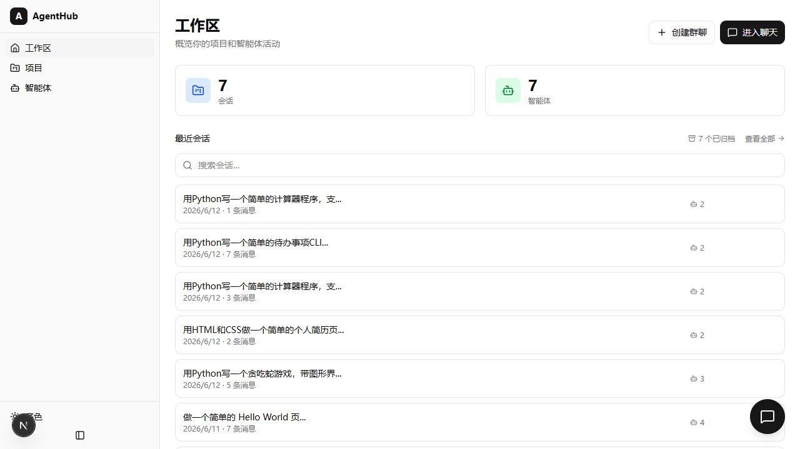
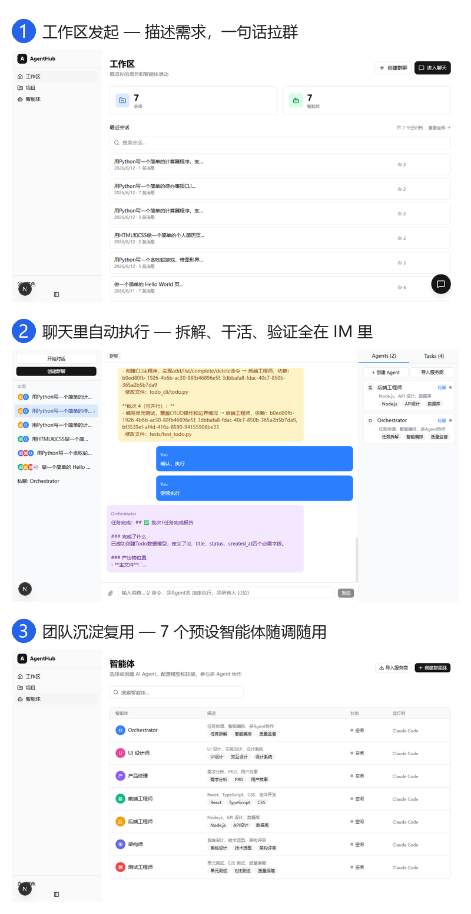

<div align="center">

# AgentHub

**A chat-style multi-agent workspace for coding agents.**

English | [简体中文](README.md)

[](https://github.com/hhhhhhh520/agenthub/actions/workflows/ci.yml)
[](LICENSE)
[](package.json)
[](tests/)
[](https://nextjs.org)
[](https://www.typescriptlang.org)





</div>

## What it is

AgentHub is a local-first workspace where you describe a task in chat and an Orchestrator assembles a team of role agents — PM, architect, frontend, backend, test, and design — to work on a real repository. Each agent runs through the Claude Code CLI or the OpenCode CLI.

It is not a model and not an IDE. It is the **orchestration and boundary layer above agent CLIs**: agent selection, task decomposition, serialized execution, file-boundary audits, permission approvals, and retries.

## Who it is for

- Developers already using Claude Code or OpenCode who want multiple agents to collaborate on one repository.
- Windows users: the test suite runs on `windows-latest`, and the adapters handle npm `.cmd` shims, `shell:true`, and process-tree cleanup.
- **Not yet** for multi-tenant, enterprise-permission, or public deployments. The current app is single-user, local, and has no authentication.

## What it does

- **Multi-agent orchestration** — seven preset agents (including the Orchestrator); group chat, 1:1 chat, and @mentions.
- **Alignment before execution** — PM confirms scope, the architect decomposes tasks, and agents ask clarifying questions. Three failed decompositions stop for human input.
- **Contract v1** — `<authoritative_input>`, `declaredFiles`, and `outputSchema` make agent-to-agent handoffs explicit instead of prompt-only.
- **File-boundary audits** — a shadow-git diff after each batch. Undeclared sensitive paths fail the whole batch; ordinary out-of-scope changes are warnings, and shared files are never auto-deleted.
- **Two CLI adapters** — Claude Code and OpenCode behind one interface, with tool allowlists, `default`/`auto` permission modes, process pooling, and config fingerprinting.
- **Role identity & permission guardrails** — agents speak as their role instead of the CLI; OpenCode sessions use auto mode, and identity/platform changes reset stale CLI sessions.
- **Session management** — search, project/time grouping, rename, auto-title from the first request, and bulk archive/delete.
- **Readable tasks & system events** — batched task progress with system checks separated, warnings consolidated into a system-event drawer, and downloadable traces. Legacy system copy is marked as historical while the raw record stays intact.
- **Guided onboarding** — a setup checklist, example prompts in an empty workspace, alignment-flow explanation, and a first-deliverable hint.
- **Stop and recover** — one session runs serially; stop/delete cancels work and waits for real process exit; failed or blocked tasks can be edited, retried, and cascaded downstream.
- **Streaming and replay** — SSE output with persisted process events and sequence-based replay after reconnect.
- **Inline artifacts** — code blocks, web preview, file cards, diffs with accept/reject, and a Monaco editor.

## Quick start

**Requirements:** Node.js 20.19+ and at least one AI CLI:

- [Claude Code CLI](https://docs.anthropic.com/en/docs/claude-code) (`npm install -g @anthropic-ai/claude-code`)
- [OpenCode CLI](https://open-code.ai) (`npm install -g opencode`)

```bash
git clone https://github.com/hhhhhhh520/agenthub.git
cd agenthub
npm install
npx prisma db push
npx tsx prisma/seed.ts
npm run dev
```

Open http://localhost:3000. The first run opens a Setup Wizard for the CLI and agent configuration.

## Security model

- **No API authentication by design.** The app is single-user and local. `npm run dev` binds to `127.0.0.1`; do not expose it with `npm start`, a LAN address, or a tunnel before adding authentication.
- **Agents have real file and command access.** They read and write files and run commands in the project directory you select. Claude Code can start in `default` mode; OpenCode is headless and cannot prompt per action, so OpenCode sessions are forced to `auto` with an explicit warning. Only use trusted repositories.
- **Do not post secrets.** Report vulnerabilities through [SECURITY.md](SECURITY.md), not a public issue with API keys or exploit details. See the [threat model](docs/security/threat-model.md) for trust boundaries and accepted risks.

## How it works

```text
Browser
  |
Next.js app (SSE)
  |-- Orchestrator: align -> DAG decomposition -> batched execution -> boundary audit -> verify/correct
  |-- Contract v1: authoritative input / declaredFiles / outputSchema / CLI session
  |-- Session lock & cancellation: serial execution, confirmed process exit on stop/delete
  |-- Adapters: Claude Code CLI / OpenCode CLI (NDJSON)
  `-- MCP server: read_artifact / list_files / list_tasks / post_message / read_messages
```

Stack: Next.js 16 · TypeScript · TailwindCSS 4 + shadcn/ui · Prisma 7 + SQLite · Monaco.

## Testing and CI

```bash
npm test          # Vitest + coverage
npm run test:e2e  # Playwright UI E2E
```

Baseline (2026-11-04): **161 test files, 1,689 passed / 3 skipped**. CI runs on `windows-latest`: full Vitest, `next build`, ESLint 0-error on changed files, and architecture guards on every push and pull request.

## Status and roadmap

- [x] Multi-agent orchestration, Contract v1, file-boundary audits, dual CLI adapters
- [ ] v0.1.0 GitHub Release with install and upgrade notes
- [ ] Multi-user isolation and authentication (required before team or public deployments)
- [ ] macOS and Linux validation

## Docs

- [Contract v1](docs/discussions/agenthub-contract-v1.md)
- [3-minute demo script](docs/demo-3min.md)
- [v2 design decisions](docs/design/agenthub-v2-design-decisions.md)
- [Workspace and permissions](docs/design/workspace-and-permissions.md)
- [Issue log](issues/)

Most design docs are currently in Chinese; English summaries are being added.

## Contributing

See [CONTRIBUTING.md](CONTRIBUTING.md) (currently in Chinese). This is a single-maintainer project, so reviews may take time.

## License

[MIT](LICENSE)
