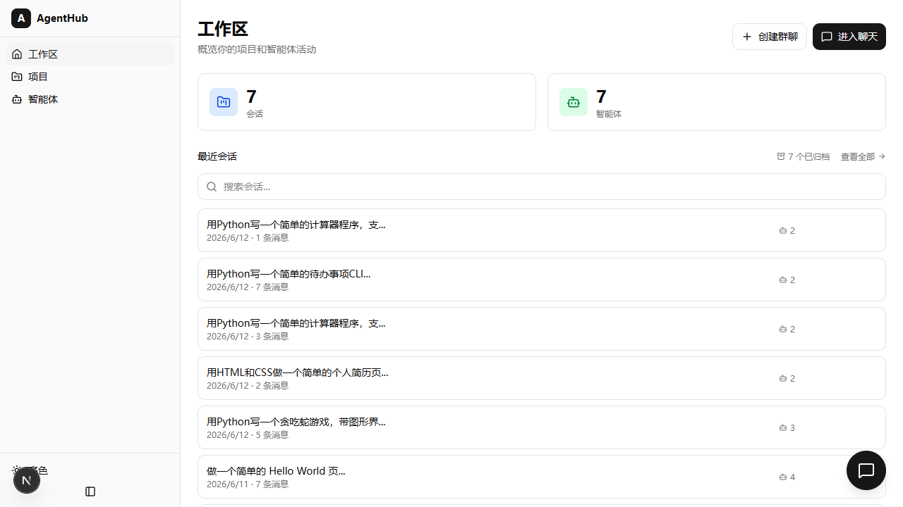
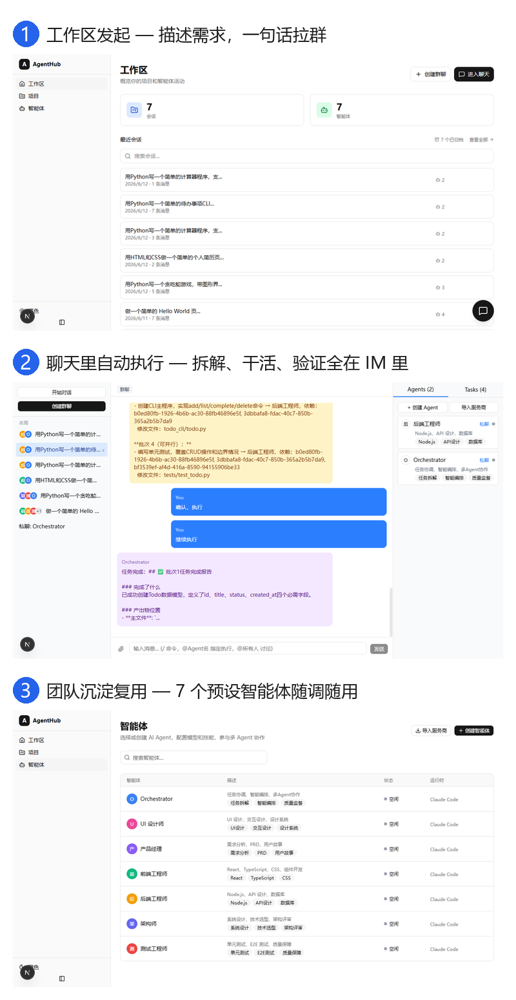

<div align="center">

# AgentHub

**IM 风格的多 Agent 协作平台** — 在聊天里拉起一支 AI 团队，Orchestrator 负责选人、拆任务、监督、纠偏。

[English](README.en.md) | 简体中文

[](https://github.com/hhhhhhh520/agenthub/actions/workflows/ci.yml)
[](LICENSE)
[](package.json)
[](tests/)
[](https://nextjs.org)
[](https://www.typescriptlang.org)





</div>

## 这是什么

AgentHub 是一个本地优先的多 Agent 工作区。你用聊天描述任务，Orchestrator 把任务拆给 PM、架构师、前端、后端、测试等角色；每个 Agent 通过 Claude Code 或 OpenCode CLI 在真实项目目录里读写代码。

它不是模型，也不是 IDE，而是 **agent CLI 之上的编排与边界控制层**：负责选人、拆任务、串行执行、文件边界审计、权限审批和失败重试。

**适合：** 已经在用 Claude Code / OpenCode，想让多个 Agent 围绕同一个仓库协作的开发者；尤其适合 Windows 用户（测试跑在 `windows-latest`）。

**不适合：** 需要多租户、企业权限或公网部署的团队——当前是单用户、本地运行，没有认证。

## 核心能力

- **多 Agent 编排** — 7 个预设 Agent（含 Orchestrator）；群聊、1v1、@ 提及。
- **先对齐再执行** — PM 确认需求 → 架构师拆解 → Agent 提问澄清；拆解失败 3 次硬停转人工。
- **Contract v1** — `<authoritative_input>`、`declaredFiles`、`outputSchema` 把 Agent 间的数据流和产物写成契约，而不是靠 prompt 自觉。
- **文件边界审计** — 每批任务后做影子 git diff；未声明的敏感路径让整批失败，普通越界只告警，共享目录文件不自动删除。
- **双 CLI 适配** — Claude Code + OpenCode 统一抽象；工具白名单、default/auto 权限模式、进程池与配置指纹隔离。
- **可停止、可恢复** — 同会话串行执行；stop/delete 会取消执行并等待进程真实退出；失败/阻塞任务可编辑后重做并级联下游。
- **流式与回放** — SSE 推送输出；过程事件落库，断线/刷新后按 seq 补发。
- **内联产物** — 代码块、Web 预览、文件卡片、Diff（Accept/Reject）、Monaco 编辑器。

## 快速开始

**前置条件：** Node.js 20.19+，以及至少一个 AI CLI：

- [Claude Code CLI](https://docs.anthropic.com/en/docs/claude-code)（`npm install -g @anthropic-ai/claude-code`）
- [OpenCode CLI](https://open-code.ai)（`npm install -g opencode`）

```bash
git clone https://github.com/hhhhhhh520/agenthub.git
cd agenthub
npm install
npx prisma db push
npx tsx prisma/seed.ts
npm run dev
```

打开 http://localhost:3000，首次启动进入 Setup Wizard 配置 CLI 和 Agent。

## 安全模型

- **无认证，按本机单用户设计。** `npm run dev` 绑定 `127.0.0.1`；不要用 `npm start` 把服务暴露到局域网/公网，除非先补认证。
- **Agent 有真实文件/命令权限。** 它会在你指定的项目目录里读写文件并执行命令；请从 `default` 权限模式开始，只对可信仓库使用。
- **不要公开贴密钥。** 安全问题请先开 issue 说明影响和复现概况，不要贴 API Key 或可直接利用的细节。

## 架构

```text
浏览器
  ↓
Next.js App（SSE）
  ├── Orchestrator：对齐 → DAG 拆解 → 分批执行 → 越界审计 → 验证/纠偏
  ├── Contract v1：权威输入 / declaredFiles / outputSchema / CLI session
  ├── Session lock & cancellation：串行执行、停止/删除的退出确认
  ├── Adapters：Claude Code CLI / OpenCode CLI（NDJSON）
  └── MCP server：read_artifact / list_files / list_tasks / post_message / read_messages
```

技术栈：Next.js 16 · TypeScript · TailwindCSS 4 + shadcn/ui · Prisma 7 + SQLite · Monaco。

## 测试与 CI

```bash
npm test          # Vitest 全量 + 覆盖率
npm run test:e2e  # Playwright UI E2E
```

当前基线：**144 个测试文件，1,562 passed / 3 skipped**。CI 在 `windows-latest` 上跑全量测试、`next build`、改动文件 ESLint 0-error 和架构守卫；每次 push/PR 都会触发。

## 路线

- [x] 多 Agent 编排、Contract v1、文件边界审计、双 CLI 适配
- [ ] 发布 v0.1.0 GitHub Release 与升级说明
- [ ] 多用户隔离与认证（团队/公网部署前）
- [ ] macOS / Linux 验证

## 文档

- [Contract v1](docs/discussions/agenthub-contract-v1.md)
- [v2 设计决策](docs/design/agenthub-v2-design-decisions.md)
- [工作区与权限](docs/design/workspace-and-permissions.md)
- [开发问题记录](issues/)

## 贡献

欢迎贡献，请先读 [CONTRIBUTING.md](CONTRIBUTING.md)。当前是单人维护，PR review 可能较慢。

## License

[MIT](LICENSE)
